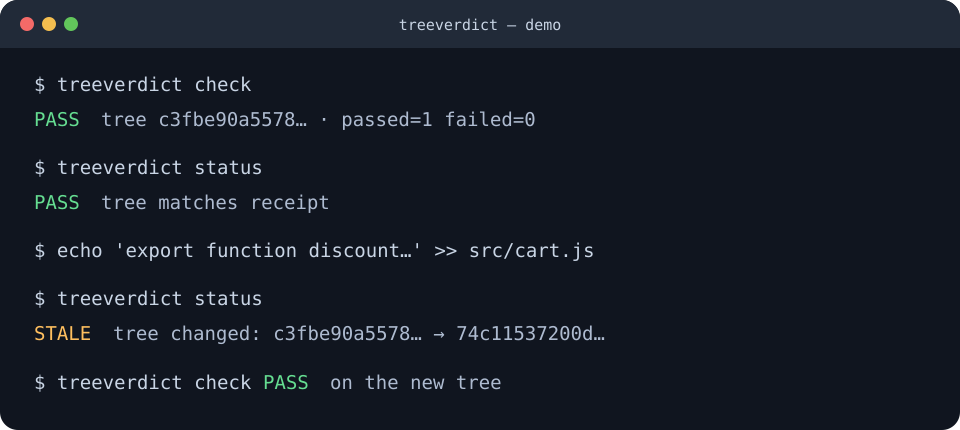

# treeverdict

**Coding agents say "done". treeverdict proves the exact code that passed.**



`treeverdict check` runs your tests without a shell, hashes covered source files before and after, and writes a receipt carrying an (unkeyed) integrity hash. `treeverdict status` recomputes the fingerprint — any code, test, or policy change since the green run returns **STALE** instead of letting an old "all tests passed" vouch for new code.

## Install

Requires Node.js ≥ 20. Zero runtime dependencies.

```sh
npm install -g treeverdict
treeverdict init --yes
treeverdict check
treeverdict status
```

Until npm publication, install from the GitHub release tarball linked in the [releases page](https://github.com/NyaTato/treeverdict/releases), or build from source with `npm ci && npm run build` and use `node dist/cli.js`.

## Why treeverdict alongside existing tools — one concrete gap (observed 2026-10-16)

Fixture: git repo with `.gitignore` containing `config.local.js`; `main.js` imports `config.local.js`; `node --test` asserts the exported value is 42.

- With value=42, `npx -y isitdone@0.8.2 --json` returned **PASS**.
- After changing ONLY the ignored runtime file to value=7, `npm test` **failed**, yet `npx -y isitdone@0.8.2 receipt --json` returned **PASS** and normal `isitdone --json` returned **cached=true PASS**.
- On the same fixture, current treeverdict returned **STALE**.

This was actually run on 2026-10-16, not inferred. It is a version-specific result for `isitdone@0.8.2` — do not generalize to future releases. Named-competitor comparison acknowledges isitdone does many other things better (hooks, HMAC receipt, larger tamper corpus). No claim is made that treeverdict is globally superior; this is one reproducible ignored-file case where a separate verifier earns its keep.

Reproduce it: benchmark case `ignored-runtime-input` covers the treeverdict side in normal CI (`npm run benchmark`, 20/20). The fixed-version comparison is opt-in and never runs in CI: `node benchmark/compare-isitdone.mjs --run-competitor` (pins `isitdone@0.8.2`, installs/runs it via `npm exec` only when requested, never added as a dependency; report normalizes away absolute local paths). Untested capabilities elsewhere in this README are marked "not tested".

## Why

An agent's "done" is a chat message. Between the green test run and your review, files can change: a follow-up edit, a mutated test, a rewritten assertion, a midnight `|| true`. Exit codes don't survive contact with `sh -c`, pipes, or `echo ALL TESTS PASSED`. treeverdict closes that gap with a separate verifier step that binds **one verdict to one exact tree**.

## 15–30 second demo

```sh
npm run demo
```

Real transcript (also saved to `.treeverdict/demo-log.txt`):

```
$ treeverdict init --yes      # record policy + test baseline (review both!)
$ treeverdict check           # PASS — tree ff05c9171089…, runner=node-test, passed=1 failed=0
$ treeverdict status          # PASS — tree matches receipt
$ echo '…' >> src/cart.js     # agent "finishes the job" after green…
$ treeverdict status          # STALE — old green no longer vouches for new code
$ treeverdict check           # PASS on the NEW tree, with a NEW receipt
```

## Exact limitations (read before trusting it)

- **Local same-user forgery is NOT cryptographically prevented.** Receipts carry an unkeyed integrity hash (plain SHA-256 over the receipt body, not a signature/MAC) that detects accidental/hand edits (`status` → `TAMPERED`), but a user with write access can regenerate a valid receipt by running `check`. treeverdict binds verdicts to trees; it does not replace signatures, code review, or trusted CI. See [SECURITY.md](SECURITY.md).
- **No sandbox.** Commands run as you, with your filesystem permissions. A malicious test script can do anything you can do. Review `policy.json` commands like you review CI config.
- **Exit code alone never means PASS.** Without a known test-runner signature (vitest/jest/mocha/node --test TAP+spec/pytest/go/TAP) or a human-reviewed `successMarker`, a green exit yields **NOT_PROVEN**. `echo`-style and shell-wrapped commands are rejected at policy validation; high-confidence failure masks inside `package.json` scripts reachable from `npm test` (`|| true`, `|| exit 0`, `; exit 0`, echo-only test scripts, `--passWithNoTests`) BLOCK with an explainable reason.
- **Test-baseline updates are not a security boundary.** `approve-tests` trusts the human. Old receipts go STALE; the new baseline is only as good as your review. New, changed, or deleted test files all BLOCK until approved.
- **Symlinks and unreadable files fail closed.** A link escaping the repo root fails the check; in-repo links are hashed by target string, never followed. Files/directories that cannot be read (EACCES/EPERM/…) fail the check — the tool never silently skips them. Transient mid-walk deletions (ENOENT) are skipped, not treated as unreadable.
- **Excluded by explicit policy:** `.treeverdict/receipts`, `.git`, `node_modules`, `dist/build/coverage`-style outputs (full list in `policy.json`). Everything else — including ignored files like `.env` — is hashed. So the fingerprint covers in-scope source files, not literally every file on disk: standard build outputs and other excluded paths are out of scope by design. Excluding more requires editing policy, which STALEs old receipts by design.

## Usage

```sh
treeverdict init [--yes] [--json]                 # write .treeverdict/policy.json + test-baseline.json
treeverdict check [--json]                        # verify now; write .treeverdict/receipts/latest.json
treeverdict status [--json]                       # PASS | STALE | TAMPERED | FAIL | NOT_PROVEN | BLOCKED
treeverdict approve-tests -m "reason" [--json]    # accept current tests as the new baseline
```

Exit codes: `0` PASS · `1` FAIL/NOT_PROVEN/STALE · `2` BLOCKED/misuse · `3` TAMPERED.

Typical agent workflow: `init` once (human reviews both files) → agent works → `check` → paste `status --json` into the final report. Reviewers re-run `status` locally.

## How it works

1. **Fingerprint** — SHA-256 over every in-scope file (tracked + untracked + git-deleted tombstones + in-scope ignored files; standard build outputs excluded per policy), sorted `path\0hash\0bytes`. Symlinks are never followed; unreadable files/dirs fail closed. `git HEAD` + `git status --porcelain` are preserved in the receipt as context.
2. **Policy gate** — `validatePolicy` rejects trivial programs (`echo`, `true`, …), shells (`sh`, `cmd`, `powershell`, …), and unsafe `cwd`; `validateNpmScripts` rejects high-confidence failure masks in `package.json` scripts reachable from `npm test`. Any policy edit changes the policy hash, which STALEs old receipts.
3. **Test gate** — `init` snapshots test-file hashes. `check` BLOCKS on changed/deleted/added tests until `approve-tests`. `.skip`/`.only`/empty files force NOT_PROVEN. Runner output must parse to real counts (or match a reviewed `successMarker`); otherwise NOT_PROVEN — never "ALL TESTS" on exit 0.
4. **Execution** — `spawn(argv[0], argv[1..], { shell: false })`, stdout/stderr/duration/exit captured (1 MiB cap per stream). Windows `.cmd` shims run via `cmd.exe /d /s /c` with per-element quoting (each argv stays literal; recorded as `via: cmd-shim`). Runner-plumbing env (`NODE_TEST_*`, `NODE_CHANNEL_*`) is stripped for hermetic runs and recorded.
5. **Mid-check guard** — the tree is hashed before AND after. Any change during the run → FAIL (`TREE CHANGED DURING CHECK`), covering build-then-mutate and test side-effects.
6. **Receipt** — JSON with verdict, reasons, per-command evidence, hashes, and an unkeyed integrity hash (tamper-evidence for accidental edits, not a signature). Receipts carry no absolute `repoRoot` (portable, no local-path leak; legacy ≤0.1.0 receipts may still contain one, which readers ignore). `status` re-verifies integrity, then recomputes policy/baseline/tree hashes: any drift → STALE (or TAMPERED on integrity mismatch). Receipt paths in CLI output are repo-relative (e.g. `.treeverdict/receipts/<stamp>.json`).

## Architecture

```
src/cli.ts                  arg parsing, dispatch
src/commands/init.ts        buildDefaultPolicy + buildBaseline
src/commands/check.ts       the verifier pipeline (gates 1–6 above)
src/commands/status.ts      re-verify: integrity → policy → baseline → tree
src/commands/approve.ts     re-baseline tests (explicit, recorded reason)
src/policy.ts               policy/baseline build, validation, test discovery
src/tree.ts                 fingerprint walk (no symlink following, exclusions)
src/exec.ts                 no-shell spawn, cmd-shim quoting, env sanitizing
src/evidence.ts             skip/only scan, runner-output parsers
src/receipt.ts              write/read/integrity-verify receipts
src/types.ts · src/util.ts  shared types, stable hashing, git helpers
  test/  unit + integration (node:test, real CLI subprocesses)
  benchmark/run.mjs  20 adversarial cases, real fixtures, JSON report
  benchmark/compare-isitdone.mjs  OPT-IN pinned isitdone@0.8.2 comparison (never CI, never a dependency)
demo/run-demo.mjs  repeatable end-to-end transcript + log
```

## Benchmark

20 adversarial cases, each a real fixture + real CLI run (never PASS-on-refusal is the bar):

| case | attack | must return |
|---|---|---|
| stale-green | edit after green | STALE |
| deleted-test | remove a test | BLOCKED |
| added-test | add an unreviewed test | BLOCKED |
| weakened-assertion | neuter an assertion | BLOCKED |
| skipped-test / only-test | `.skip` / `.only` | NOT_PROVEN |
| masked-exit-code | `sh -c '… \|\| true'` | BLOCKED |
| masked-npm-test | `package.json` test script `node --test \|\| true` via real `npm test` | BLOCKED |
| wrong-cwd | run tests in the wrong dir | FAIL/NOT_PROVEN |
| source-changed-after-test | test run rewrites src | FAIL |
| changed-validation-command | swap command post-green | STALE |
| empty-test / missing-test | no real tests | NOT_PROVEN/FAIL |
| untracked-file | hidden file after green | STALE |
| symlink-escape | link outside repo | FAIL (closed) |
| false-all-tests | `echo ALL TESTS PASSED`, exit 0 | NOT_PROVEN |
| build-pass-then-source-change | green must follow code (STALE between, then PASS on new hash) | PASS on new hash |
| receipt-manually-edited | tamper with receipt | TAMPERED |
| approve-tests-flow | reviewed change unblocks | PASS |
| ignored-runtime-input | edit ONLY an ignored runtime file (`config.local.js` 42→7) after green; real `node --test` then fails | STALE |

```sh
npm run benchmark   # 20/20 in ~10s; report: .treeverdict/benchmark/results.json
```

The `ignored-runtime-input` case is the first-party cover for the concrete gap
described at the top of this README (same fixture shape as the observed
`isitdone@0.8.2` comparison; that comparison itself stays opt-in under
`benchmark/compare-isitdone.mjs` and never runs in CI).

## Prior art (named comparison)

One fixed-version observation plus design comparisons. "Observed" below means
actually executed on 2026-10-16 against the stated version; "not tested" means
not executed here. No superiority claim is made; each tool makes different trade-offs.

| project | source | what it does (as documented) | how treeverdict differs (design) |
|---|---|---|---|
| isitdone | https://github.com/raimondasl/isitdone | Stop hook + CLI + MCP server + GitHub Action that runs the repo's real test/typecheck/lint on the working tree before the agent says done (observed: `isitdone@0.8.2` only — ignored-runtime-input fixture above: pre-edit `--json` PASS, post-edit `receipt --json` PASS + normal `--json` cached=true PASS while `npm test` failed; not tested: hook behavior, other runners/versions) | treeverdict is a standalone offline verifier with no hooks: it binds one verdict to one exact tree hash (before+after, ignored-in-scope files included), BLOCKS on test-baseline drift, and refuses PASS without parsed runner evidence. isitdone does many other things better (hooks, HMAC receipt, larger tamper corpus) |
| backcheck | https://github.com/VectorInstitute/backcheck | Checks a Claude Code agent's claims against its own session transcript (zero LLM calls); transcript-based, not a test runner (not tested: transcript parsing) | treeverdict re-runs the tests itself and hashes the tree instead of reading transcripts; it does not parse agent sessions |
| Prove It | https://github.com/searlsco/prove_it | Stop-hook gate using a repo verification script (not tested here) | treeverdict ships a standalone verifier with test-baseline, mid-check mutation, and receipt checks |
| agent-done-or-not | https://github.com/mohamedzhioua/agent-done-or-not | Proof gate for coding agents (not tested here) | treeverdict focuses on an independently rerunnable local CLI and the ignored-runtime-input case above; feature superiority not assessed |
| driver-os | https://github.com/AccursedGalaxy/driver-os | Headless Go coding-agent harness with external verify-command gates and typed outcomes (not tested: harness, gates) | treeverdict is not a harness: it is a post-hoc verifier that runs after any agent/harness and re-checks the tree offline via `status` |
| GitHub Actions (CI green badge) | https://github.com/features/actions | Tests pass on CI's checkout for a commit (not tested: CI pipelines not run here) | a badge refers to a commit, not your worktree; treeverdict checks the local worktree (tracked + untracked + ignored-in-scope files) and STALEs on any drift |

## Privacy

The verifier itself is fully local: no network calls, no telemetry, no accounts. Receipts stay in `.treeverdict/` (excluded from fingerprints). However, the commands it runs (your test suite, typecheck, etc.) are your code and may access the network — treeverdict does not sandbox or block that. Nothing leaves your machine unless you paste it.

## Contributing

See [CONTRIBUTING.md](CONTRIBUTING.md). Bug reports covering a way to get an unjustified PASS are especially welcome — include a benchmark-style fixture.

## License

MIT © 2026 NyaTato. See [LICENSE](LICENSE).
